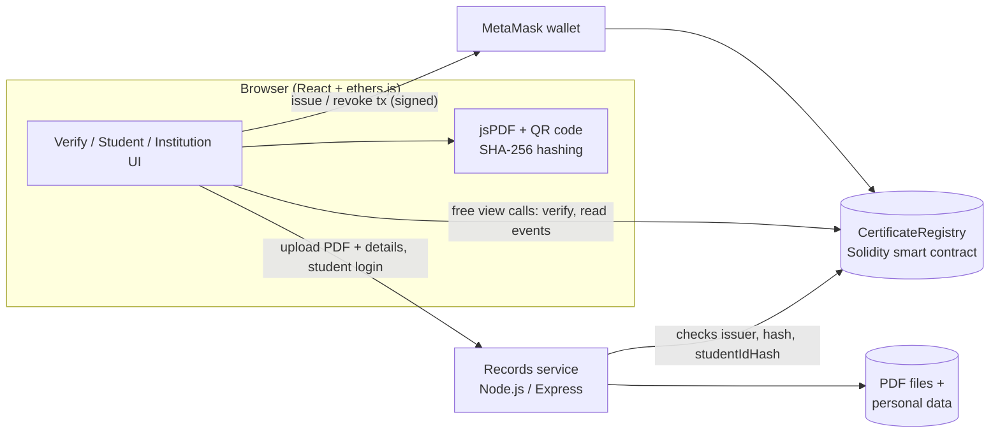
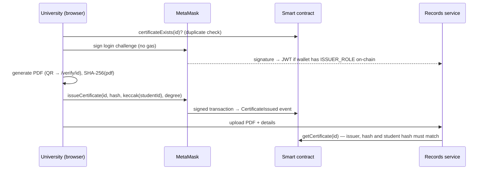

# CertChain — Blockchain-Based Academic Certificate Verification

> CSCI2730 Introduction to Blockchain · Development stream project
> Beh Jia Xin (1155283623) · Nguyen Le Thanh Nguyen (1155227835)

CertChain lets universities issue academic certificates whose authenticity anyone can check **without trusting the
university's database**. When a certificate is issued, the SHA-256 fingerprint of the exact PDF is anchored in an
Ethereum smart contract. A verifier re-hashes the file they received and compares it with the immutable on-chain
record: changing even one character of the PDF changes the hash, so forged or edited certificates are detected
instantly.

| Role | What they can do |
| --- | --- |
| **Platform admin** (`DEFAULT_ADMIN_ROLE`) | Register / deactivate universities, revoke any certificate |
| **University** (`ISSUER_ROLE`) | Issue single or batch certificates, revoke its own certificates, view & search them |
| **Student** | Register / sign in, view certificates with live blockchain status, download PDF, share link / QR code |
| **Verifier** (anyone) | Upload a PDF or scan the QR code → *Authentic*, *Invalid*, *Revoked* or *Not found*; optionally log the check on-chain |

---

## Contents
1. [Architecture](#architecture)
2. [Features](#features)
3. [Quick start (local)](#quick-start-local)
4. [Demo walkthrough](#demo-walkthrough)
5. [Smart contract](#smart-contract)
6. [Testing](#testing)
7. [Deploying to Sepolia (optional)](#deploying-to-sepolia-optional)
8. [Project structure](#project-structure)
9. [Security & design decisions](#security--design-decisions)
10. [Troubleshooting](#troubleshooting)

---

## Architecture



**What lives where**

| On-chain (public, immutable) | Off-chain (records service) |
| --- | --- |
| Certificate ID, SHA-256 of the PDF, `keccak256(studentId)`, degree title, issuer address, issue / revoke timestamps, revocation reason, verification count, all events | Student name, e-mail, full student ID, major, honours, graduation date, the PDF file, student accounts (bcrypt-hashed passwords) |

The backend is **not trusted for verification**. It refuses to store any PDF whose hash, issuer or student-ID hash
does not match the chain, and verifiers always compare against the contract directly from their browser.

### Issuance flow



### Verification logic (on-chain, `verifyCertificate`)

| Condition | Result |
| --- | --- |
| No record for the certificate ID | **Not found** |
| Record exists but `SHA-256(file) ≠ certHash` | **Invalid** (modified / forged) |
| Hash matches but certificate revoked | **Revoked** |
| Hash matches and not revoked | **Authentic** |

If the ID is unknown, the verifier falls back to `verifyByHash(hash)`. The certificate ID is detected automatically
from the PDF metadata of CertChain-generated files.

---

## Features

Core
- Wallet-based access control (OpenZeppelin `AccessControl`) — only registered universities can issue
- Issue certificate → PDF generation, SHA-256 hash, on-chain anchoring, transaction hash as proof of issuance
- View / search / filter issued certificates with issuance date and transaction details
- Revoke with a public reason (only the issuer or platform admin)
- Student registration / login, certificate list with live status, PDF download
- Verify by uploading a PDF → Authentic / Invalid / Revoked / Not found
- QR code on every certificate → verification page with the live on-chain status

Additional
- **Duplicate prevention** — same certificate ID or same document hash cannot be registered twice
- **Multiple universities** — admin registers / deactivates institutions; their old certificates stay valid
- **Batch issuance** — up to 50 certificates from a CSV in **one atomic transaction** (lower gas per certificate)
- **Verification history** — verifiers can log a check on-chain (`CertificateVerified` event); full timeline per certificate
- **Wallet sign-in (SIWE-style)** — institutions authenticate to the backend with an ECDSA signature, no password
- **Proof of issuance** — transaction hash, block, gas used, sender; Etherscan links on Sepolia
- **Shareable verification link** and QR modal for students
- **Privacy by design** — no personal data on-chain; student ID stored only as a hash
- Tamper-simulation tool (`tools/tamper-pdf.mjs`) for demonstrating forgery detection

---

## Quick start (local)

**Prerequisites:** Node.js 18+ (20/22 recommended), Chrome/Edge/Brave with the [MetaMask](https://metamask.io) extension.

```bash
# 1. Install dependencies for all three parts
npm run setup

# 2. Terminal 1 — start a local Ethereum chain (Hardhat, chain ID 31337)
npm run chain

# 3. Terminal 2 — compile & deploy the contract, register demo universities
npm run deploy

# 4. Terminal 2 — start the backend (http://localhost:4000)
npm run backend

# 5. Terminal 3 — start the web app (http://localhost:5173)
npm run frontend
```

> On Windows you can run the same commands in PowerShell or the VS Code terminal.
> Copy `backend/.env.example` to `backend/.env` and set `JWT_SECRET` (optional for local use).

### Configure MetaMask

1. MetaMask → *Add network manually*:
   **Network name** `Hardhat Local` · **RPC URL** `http://127.0.0.1:8545` · **Chain ID** `31337` · **Currency** `ETH`
   (the app also offers to add/switch the network automatically).
2. Import the Hardhat test accounts printed by `npm run chain` (*Import account → private key*):

| Account | Role after `npm run deploy` |
| --- | --- |
| #0 `0xf39F…2266` | Platform admin **and** "The Chinese University of Hong Kong" |
| #1 `0x7099…79C8` | "Demo Partner University" |
| #2 `0x3C44…93BC` | Not registered — use as a verifier / to show access control |

> ⚠️ These keys are public Hardhat development keys. Never send real funds to them.

---

## Demo walkthrough

1. **Institution console** (`/issuer`) — connect account #0, open **Issue**, fill in a student and click
   *Issue on blockchain*. Sign the login message, confirm the transaction, then download the PDF.
2. **Student portal** (`/student`) — create an account with the same student ID and e-mail; the certificate appears
   with status *Valid*. Download the PDF and open the QR code.
3. **Verify** (`/verify`) — drop the PDF → **Authentic**, with the on-chain record, proof of issuance and history.
4. **Forgery** — create a modified copy that still looks genuine:
   ```bash
   npm run tamper -- path/to/CUHK-2026-XXXXXX.pdf "Second Class Honours" "First Class Honours"
   ```
   Verify the `-tampered.pdf` → **Invalid**, fingerprints differ.
5. **Revocation** — in *Certificates*, revoke the certificate with a reason. Verify again → **Revoked**.
6. **Batch** — *Batch issue* → upload `docs/sample-batch.csv` → 5 certificates in one transaction.
7. **Multi-university** — *Institutions* tab (admin) → register account #2; switch MetaMask to account #1 and show it
   cannot revoke CUHK's certificates.
8. **QR on a phone** — open the app via your LAN IP (e.g. `http://192.168.1.20:5173`) or set
   `VITE_PUBLIC_APP_URL` in `frontend/.env` *before issuing*, so the QR code points to an address the phone can reach.
   `npm run chain` already listens on all interfaces.

---

## Smart contract

`blockchain/contracts/CertificateRegistry.sol` (Solidity 0.8.24, OpenZeppelin 5)

| Function | Access | Purpose |
| --- | --- | --- |
| `addInstitution(address, name)` | admin | Register / re-activate a university, grants `ISSUER_ROLE` |
| `deactivateInstitution(address)` | admin | Stop a university issuing (old certificates stay valid) |
| `issueCertificate(certId, certHash, studentIdHash, degree)` | active issuer | Register one certificate |
| `issueCertificatesBatch(ids[], hashes[], studentHashes[], degrees[])` | active issuer | Up to 50 in one atomic tx |
| `revokeCertificate(certId, reason)` | issuer of that cert or admin | Mark as revoked |
| `verifyCertificate(certId, hash)` | anyone (view) | `NotFound / Authentic / Invalid / Revoked` |
| `verifyByHash(hash)` | anyone (view) | Look up by fingerprint only |
| `recordVerification(certId, hash)` | anyone (tx) | Verify + emit `CertificateVerified` audit event |
| `getCertificate`, `certificateExists`, `getCertificatesByStudent`, `getCertificatesByIssuer`, `getCertificates(offset, limit)`, `getInstitutions`, `totalCertificates` | anyone (view) | Reads |

Events: `InstitutionAdded`, `InstitutionDeactivated`, `CertificateIssued`, `CertificateRevoked`, `CertificateVerified`.
Custom errors (e.g. `CertificateAlreadyExists`, `NotCertificateIssuer`) are decoded into readable messages in the UI.

The contract can also be compiled and deployed in **Remix** (imports from `@openzeppelin/contracts` resolve automatically).

---

## Testing

```bash
npm test                 # 23 unit tests (Hardhat + Chai)
cd blockchain && REPORT_GAS=true npx hardhat test   # with gas report
cd blockchain && npx hardhat coverage               # coverage report
```

Covered: role-based access control, institution lifecycle, issuance, duplicate ID / hash prevention, input
validation, batch atomicity and size limits, all four verification outcomes, lookup by hash, per-student listing,
pagination, revocation permissions and edge cases, on-chain verification logging.

Manual end-to-end checklist (used for the demo):

| # | Scenario | Expected |
| --- | --- | --- |
| 1 | Unregistered wallet opens the console | "Wallet not authorised" |
| 2 | Issue with an existing certificate ID | Blocked before sending the transaction |
| 3 | Verify the original PDF | Authentic |
| 4 | Verify a tampered PDF | Invalid, fingerprints differ |
| 5 | Verify after revocation | Revoked + reason |
| 6 | Verify an unrelated PDF | Not found |
| 7 | Open `/verify/<id>` (QR) | Live status without uploading |
| 8 | University B tries to revoke University A's certificate | Rejected (`NotCertificateIssuer`) |
| 9 | Student with a different e-mail | Certificate not shown / not downloadable |

---

## Deploying to Sepolia (optional)

1. Get Sepolia test ETH and an Alchemy (or Infura) RPC URL.
2. `cp blockchain/.env.example blockchain/.env` and fill in `SEPOLIA_RPC_URL` and `DEPLOYER_PRIVATE_KEY`
   (a test wallet only). Optionally `INSTITUTIONS=0xabc…=University A,0xdef…=University B`.
3. `npm run deploy:sepolia --prefix blockchain`
4. Set `RPC_URL` in `backend/.env` and `VITE_RPC_URL` in `frontend/.env` to the same Sepolia RPC URL and restart.
   Transaction hashes then link to Sepolia Etherscan.

---

## Project structure

```
certchain/
├── blockchain/                 Hardhat project
│   ├── contracts/CertificateRegistry.sol
│   ├── scripts/deploy.js       deploys, registers universities, exports ABI + address
│   └── test/CertificateRegistry.test.js
├── backend/                    Express records service
│   └── src/
│       ├── server.js           app, CORS, error handling
│       ├── auth.js             student auth (bcrypt + JWT), wallet sign-in (ECDSA)
│       ├── certificates.js     upload (verified against chain), list, download
│       ├── chain.js            read-only contract access
│       └── store.js            JSON file store + content-addressed PDF files
├── frontend/                   React (Vite) + ethers v6
│   └── src/
│       ├── lib/                chain.js, wallet.jsx, pdf.js, issue.js, api.js, format.js
│       ├── components/         Layout, UI kit, certificate history, progress
│       └── pages/              Home, Verify, Student, issuer/*
├── tools/tamper-pdf.mjs        forgery simulation for the demo
└── docs/                       report, demo script, sample CSV
```

---

## Security & design decisions

- **Hash the exact bytes, not the data.** The PDF is generated once and its SHA-256 is anchored; the same bytes are
  stored for download, so any edit is detectable. The QR code and certificate ID are embedded *before* hashing.
- **Minimal on-chain data.** Blockchains are public and permanent; storing names or e-mails would violate privacy
  (and the GDPR/PDPO "right to erasure"). Only hashes and the degree title are stored. Note that a hash of a short
  student ID could be brute-forced; a production system would add a per-student secret salt.
- **Least privilege.** Universities can only revoke their own certificates; deactivating a university does not
  invalidate history. Issuance requires both `ISSUER_ROLE` and an active institution record, so a role granted
  without registration cannot issue.
- **Atomic batches.** A batch either fully succeeds or fully reverts, avoiding half-issued cohorts.
- **Untrusted backend.** The server holds no private key and cannot forge a valid certificate; it re-checks every
  upload against the chain. Wallet sign-in uses one-time nonces to prevent signature replay.
- **Gas.** Verification is a free `view` call; only issuance, revocation and optional verification logging cost gas.

**Limitations / future work:** IPFS storage of encrypted PDFs, salted student hashes or zero-knowledge proofs for
selective disclosure, W3C Verifiable Credentials format, multi-signature approval for revocation, an L2 deployment to
reduce gas costs.

---

## Troubleshooting

| Problem | Fix |
| --- | --- |
| Banner "Smart contract not deployed" | Run `npm run deploy` while `npm run chain` is running, then reload |
| `Nonce too high` / stuck transactions after restarting the chain | MetaMask → Settings → Advanced → **Clear activity tab data** |
| Backend says contract not deployed | Deploy first; the backend reads `backend/deployment.json` |
| Restarted `npm run chain` | The local chain is reset — run `npm run deploy` again (old backend records are kept per contract address and ignored) |
| Student sees no certificates | Account e-mail must match the e-mail the university entered |
| QR code does not open on a phone | Use the LAN IP (see demo step 8) and allow ports 5173/4000/8545 in the firewall |
